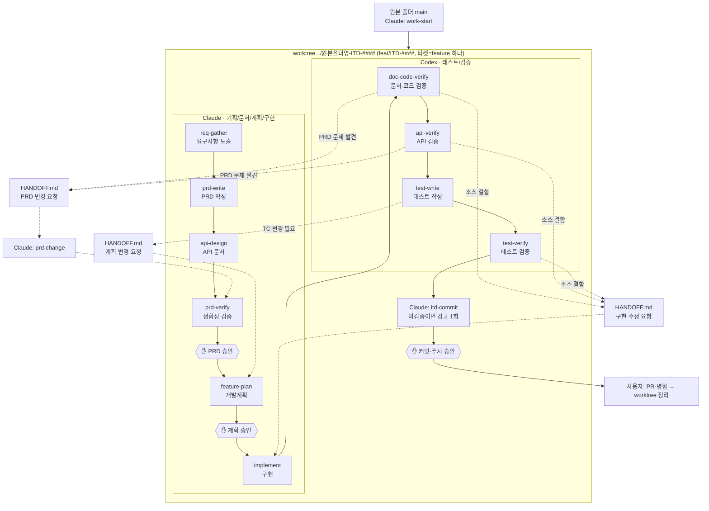

# init-harness

SI 프로젝트(보통 4~5일 단위)를 위한 **Claude·Codex 분업 하네스**입니다. Claude가 기획·문서·개발계획·구현을, Codex가 테스트와 검증을 맡고, 모든 결과물은 요구사항 ID로 이어져 검증됩니다.

**핵심 원칙**

- **역할 분리**: Claude는 문서·계획·소스를, Codex는 테스트 코드와 검증 산출물만 고칩니다. 한 티켓의 구현을 한 모델이 맡아 코드가 일관되고, 다른 모델이 검증합니다. 훅이 서로의 영역 편집을 막습니다.
- **끊겨도 이어 감**: 세션이 사용량 한도나 계정 전환으로 끊겨도 `HANDOFF.md`의 진행 위치와 worktree의 파일로 이어 갑니다. Claude 세션이 시작되면 훅이 인계 상태를 자동으로 보여줍니다.
- **티켓 하나 = worktree 하나**: 원본 폴더는 항상 `main`으로 두고, 티켓(=feature)마다 브랜치와 worktree를 따로 만들어 문서부터 구현까지 그 안에서 끝냅니다. 여러 티켓을 병렬로 진행할 수 있습니다.
- **문서가 원본**: 요구사항, PRD, API 문서가 기준입니다. 코드는 문서를 따르고, 문서를 바꿔야 하면 정해진 경로로 되돌아갑니다.
- **사람이 승인**: 다음 단계로 넘어가는 네 지점(PRD, 계획, 커밋, 푸시)은 사용자가 승인 문구를 직접 입력해야 열립니다.
- **작성자 ≠ 검증자**: 검증은 항상 새 컨텍스트의 별도 에이전트가 원문만 보고 판정합니다.
- **ID로 추적**: `REQ → PRD → API → PLAN → 테스트`가 ID로 연결되고, 누락은 스크립트가 기계적으로 찾습니다.

## 목차

1. [요구 환경](#1-요구-환경)
2. [시작하기](#2-시작하기)
3. [전체 흐름](#3-전체-흐름)
4. [단계별 절차](#4-단계별-절차)
5. [승인 게이트](#5-승인-게이트)
6. [추적과 검증](#6-추적과-검증)
7. [되돌림: PRD 변경 요청](#7-되돌림-prd-변경-요청)
8. [대행 작업](#8-대행-작업)
9. [예외: 하네스 도입·업데이트](#9-예외-하네스-도입업데이트)
10. [Git 규칙](#10-git-규칙)
11. [훅이 막는 것](#11-훅이-막는-것)
12. [모델 구성](#12-모델-구성)
13. [디렉터리 구조](#13-디렉터리-구조)
14. [제약사항](#14-제약사항)
15. [문제 해결](#15-문제-해결)

---

## 1. 요구 환경

| 항목 | 내용 |
| --- | --- |
| OS | macOS, Linux, Windows (훅이 POSIX `sh`를 사용. Windows는 Git for Windows의 Git Bash) |
| 도구 | `git`, `jq`, Node.js 18 이상. `jq`가 없으면 훅이 모든 도구를 차단합니다 |
| Windows 설치 | `winget install Git.Git jqlang.jq OpenJS.NodeJS.LTS` 후 VS Code·터미널 재시작. Codex 훅은 `sh`를 직접 호출하므로 `C:\Program Files\Git\usr\bin`을 PATH에 추가 |
| AI 도구 | Claude Code (Pro 이상), Codex (Plus 이상) |
| 대상 스택 | Java + Spring Boot 기본. DB·메시지 큐 등은 프로젝트마다 `project-init`에서 결정 |

Claude와 Codex는 **같은 PC의 같은 worktree 폴더**에서 씁니다. 승인 기록(`.harness/state/`)이 git에 올라가지 않는 로컬 파일이고 worktree마다 따로 남기 때문입니다.

## 2. 시작하기

상황에 맞는 방법 하나를 고릅니다.

### 2-1. 새 프로젝트

```bash
git clone https://github.com/sju3358/init-harness.git <프로젝트명>
cd <프로젝트명>
git rev-parse HEAD > .harness/version   # 설치한 하네스 버전 기록 (업데이트 기준)
rm -rf .git && git init -b main         # 하네스 이력을 끊고 프로젝트 저장소로 시작
```

Claude 세션을 열고 **"프로젝트 초기 셋팅해줘"** 라고 하면 `project-init`이 다음을 진행합니다.

1. 스택을 질문합니다. Java·Spring Boot 버전, 빌드 도구, DB, ORM, 메시지 큐, 인증, 배포 대상, 테스트 방식을 매번 묻습니다.
2. 답을 `docs/project.md`에 기록하고, 검증 명령(빌드·테스트)이 맞는지 확인받습니다.
3. Git 훅을 등록합니다(`core.hooksPath`).
4. 초기 커밋과 `main` push 명령을 안내합니다. 이 작업은 사용자가 직접 실행합니다.

이 폴더(원본 폴더)는 이후에도 `main`으로 둡니다. 티켓 작업은 이 폴더의 Claude 세션에서 **"ITD-1234 작업 시작해줘"** 라고 해서 worktree를 만든 뒤, 그 worktree 폴더에서 새 세션을 열어 진행합니다([3장](#3-전체-흐름)).

### 2-2. 진행 중인 프로젝트에 도입

하네스가 없는 기존 프로젝트 루트에서 Claude 세션을 열고 **"이 프로젝트에 하네스 도입해줘"** 라고 합니다. `harness-adopt`가 하네스를 받아 기존 파일(`CLAUDE.md`, 설정, Git 훅)과 병합하고, 코드를 읽어 `docs/project.md`를 채웁니다. `하네스 도입 승인`을 입력하면 하네스 파일만 main에 바로 커밋·push합니다. 자세한 내용은 [9장](#9-예외-하네스-도입업데이트)에 있습니다.

### 2-3. 이미 설치된 하네스 업데이트

**"하네스 업데이트해줘"** 라고 합니다. 기준 버전은 `.harness/version`을 쓰고, 이 파일이 없는 구버전 프로젝트는 설치 당시 커밋을 알려줘야 합니다. 구버전 프로젝트에는 `harness-update` 스킬이 없으므로 이렇게 지시합니다.

```
init-harness를 임시 폴더에 clone해서, 그 안의 .claude/skills/harness-update/SKILL.md 절차대로
하네스 업데이트해줘. 기준 커밋은 <설치 당시 커밋>.
```

## 3. 전체 흐름



- **원본 폴더는 항상 `main`** 입니다. 여기서는 `work-start`(worktree 생성), 초기 셋팅, 하네스 도입·업데이트만 하고 문서·계획·코드 편집은 훅이 막습니다.
- **티켓마다 worktree 하나**를 원본 폴더의 형제 폴더(`../<원본 폴더명>-ITD-####`)에 만듭니다. Claude·Codex 세션은 이 폴더에서 엽니다. Codex는 세션 폴더 밖에 쓸 수 없고, 승인 기록도 worktree마다 따로 남기 때문입니다.
- 동시에 편집하는 세션마다 자기 worktree를 씁니다. Claude가 티켓 B를 구현하는 동안 Codex가 티켓 A를 검증하거나, Claude 세션 둘이 두 티켓을 동시에 진행할 수 있습니다. 한 worktree에서는 Claude → Codex 순서로 이어 받습니다.
- PR 생성과 병합은 **사람이 직접** 합니다. 에이전트는 작업 브랜치까지만 push합니다. 병합 후 원본 폴더에서 `git worktree remove`, `git branch -d`로 정리합니다.
- Claude와 Codex는 대화가 아니라 **파일로 인계**합니다. 다음 담당자는 같은 worktree의 `artifacts/work/F-##/HANDOFF.md`부터 읽습니다.
- 절차의 단일 원본은 [docs/rules/workflow.md](docs/rules/workflow.md)입니다. 이 README는 요약입니다.

## 4. 단계별 절차

### 4-1. Claude: 작업 시작·기획·문서·계획·구현

| 단계 | 이렇게 말하면 | 하는 일 | 산출물 | 다음으로 넘어가는 조건 |
| --- | --- | --- | --- | --- |
| 작업 시작 | (원본 폴더에서) "ITD-1234 작업 시작해줘" | 티켓 번호·종류를 확인하고 `main`을 최신화한 뒤 브랜치와 worktree를 만듭니다 | `feat/ITD-1234`, `../<원본 폴더명>-ITD-1234` | 그 폴더에서 새 Claude 세션을 엶 |
| 요구사항 | "요구사항 정리해줘", "Notion 기획서 읽어줘" | Notion(MCP)과 대화에서 **이 티켓 범위의** 요구사항을 뽑아 `REQ-###`, 인수 기준, 출처를 적습니다. 불확실한 건 미결 질문(`Q-###`)으로, 다른 feature 요구는 별도 티켓 후보로 분리합니다 | `docs/requirements.md` | 요구사항마다 판정 가능한 인수 기준이 있음 |
| PRD | "PRD 작성해줘" | 이 티켓의 feature(`F-##`)를 먼저 확인받고 개요, 스킬셋, 공통 사항, 기능 명세, 배포·운영을 씁니다. 모든 규정에 근거 REQ를 답니다 | `docs/prd/**` | `check-trace.sh prd` 통과 |
| API 문서 | "API 문서 작성해줘" | 프론트 전달용 Markdown 문서를 씁니다. 엔드포인트(`API-###`)마다 필드, 타입, 필수, null 가능, 에러를 적고 변경 이력을 남깁니다. 마지막에 전달용 요약을 줍니다 | `docs/api/**` | PRD의 모든 API가 필드 단위까지 문서화됨 |
| 검증 | "PRD 검증해줘" | `prd-verifier`(새 컨텍스트)가 요구사항, PRD, API를 대조해 판정하고, 메인 세션이 그 결과를 다시 확인합니다 | `docs/verification/prd-verify.md` | 결론 `승인 가능`, 사람 승인 필요 항목 답변 완료 |
| ✋ 승인 | `PRD 승인` 입력 | 요구사항·PRD·API 문서의 내용 해시를 이 worktree에 기록합니다 | 문서 상태 `승인 vX.Y` | 계획 작성 가능 |
| 계획 | "개발계획 작성해줘" | REQ·API → 변경 파일 → 테스트 케이스(`TC-F01-##`)를 매핑합니다. 사람이 정할 항목은 근거와 함께 질문합니다 | `artifacts/work/F-01/PLAN.md` | 확인 필요 항목 답변 완료 |
| ✋ 승인 | `계획 승인` 입력 | 이 브랜치의 소스(Claude)·테스트(Codex) 편집을 허용합니다 | | |
| 구현 | "구현 시작해" | 계획과 API 문서대로 구현하고, 파일 묶음마다 `HANDOFF.md` "진행 위치"를 갱신합니다. 계획에서 벗어나야 하면 멈추고 `PLAN.md`를 고쳐 재승인을 받습니다 | 소스 코드 | 컴파일 통과 → 같은 worktree에서 Codex 세션을 엶 |
| 수정 반영 | "구현 수정 요청 반영해" | Codex가 `HANDOFF.md` "구현 수정 요청"에 남긴 결함을 근거를 확인하고 고칩니다 | 소스 코드 | Codex 재검증 |

계획 이탈의 예: 계획에 없는 파일(공통 예외 처리기 수정 등)·라이브러리·DB 스키마 변경, 재사용하려던 클래스가 맞지 않음. 같은 파일 안 private 메서드 추가나 이름 조정 같은 사소한 이탈은 `PLAN.md` "계획 변경 이력"에 `기록만`으로 적고 진행합니다.

### 4-2. Codex: 테스트·검증 (같은 worktree)

Codex는 소스를 고치지 않습니다. 결함은 `HANDOFF.md`에 적어 Claude에 넘깁니다(소스 결함 → "구현 수정 요청", TC 문제 → "계획 변경 요청", 문서 문제 → "PRD 변경 요청").

| 단계 | 이렇게 말하면 | 하는 일 | 산출물 | 다음으로 넘어가는 조건 |
| --- | --- | --- | --- | --- |
| 문서-코드 검증 | "HANDOFF 읽고 이어서 진행해" | `verifier`가 REQ마다 `파일:줄` 근거로 PRD와 코드를 대조합니다 | `VERIFY.md` | 수정 필요 0건 |
| API 검증 | "API 검증해" | `check-api.mjs`로 엔드포인트 목록을 기계 비교하고, `verifier`가 파라미터·필드·에러 코드를 항목별로 대조합니다 | `API-VERIFY.md` | 불일치 0건 |
| 테스트 작성 | "테스트 작성해" | TC마다 테스트를 쓰고 `@DisplayName("[TC-F01-03][REQ-012] ...")`처럼 ID를 붙입니다 | 테스트 코드 | `check-trace.sh feature F-01` 통과 |
| 테스트 검증 | "테스트 검증해" | 테스트를 실행하고, `verifier`가 각 테스트가 인수 조건을 실제로 검사하는지 판정합니다. 끝나면 `HANDOFF.md` 다음 행동을 `Claude itd-commit`으로 적고 멈춥니다 | `TEST-REPORT.md`, `docs/traceability.md` | 실패 0건, 무효·약함 판정 0건 |

### 4-3. Claude: 커밋·푸시 (같은 worktree)

| 단계 | 이렇게 말하면 | 하는 일 | 산출물 |
| --- | --- | --- | --- |
| ✋ 승인 | "커밋해줘" 후 `커밋 승인`, `푸시 승인` 입력 | `itd-commit`이 검증·테스트 상태를 확인하고 ITD 형식 메시지를 보여 준 뒤, 승인 후 커밋하고 작업 브랜치에 push합니다 | 커밋 |

- **테스트·검증 전에도 커밋할 수 있습니다.** 막지는 않지만 `itd-commit`이 미충족 항목(문서-코드·API 검증, 테스트 실행·유효성, 대기 중인 수정 요청, 검증 이후 소스 변경)을 근거와 함께 **1회 경고**하고, 사용자가 "미검증 상태로 커밋" / "멈추고 Codex 검증부터" 중에서 고릅니다. 미검증으로 진행하면 커밋 본문에 `- 미검증: <항목>`이 남습니다.
- Codex는 커밋·push하지 않습니다. worktree의 Git 메타데이터(`index.lock` 등)가 원본 폴더 `.git/`에 있어, worktree 폴더만 쓸 수 있는 Codex 샌드박스에서는 `git commit`이 권한 오류로 실패하기 때문입니다.

Codex는 한 세션에서 문서-코드 검증부터 테스트 검증까지 이어서 진행합니다. 단계마다 `HANDOFF.md`를 갱신하고, Claude에 넘길 요청이 생기거나 사람 승인 필요 항목이 나오거나 테스트 검증이 끝나면(커밋은 Claude로) 멈춥니다.

### 4-4. 세션이 끊겼을 때 (사용량 한도·계정 전환)

- 작업 결과 파일은 worktree에 그대로 남고, 잃는 것은 대화 맥락뿐입니다. Claude는 구현 중 파일 묶음마다 `HANDOFF.md` "진행 위치"(끝난 것, 진행 중, 다음 할 일, 결정)를 갱신합니다.
- 다른 계정이나 새 세션으로 같은 worktree 폴더에서 Claude를 열면 `SessionStart` 훅이 `HANDOFF.md`의 상태·진행 위치와 `git status`를 자동으로 보여줍니다. "이어서 진행해"라고 하면 됩니다.
- Codex는 새 세션에서 "HANDOFF 읽고 이어서 진행해"라고 합니다.

## 5. 승인 게이트

| 입력 문구 | 열리는 것 | 유효 범위 | 막는 장치 |
| --- | --- | --- | --- |
| `PRD 승인` | 개발계획 작성 | 해당 worktree, 요구사항·PRD·API 문서 내용이 바뀌기 전까지 | `prd-check.sh` (해시 비교) |
| `계획 승인` | 소스·빌드 파일 편집(Claude), 테스트 코드 편집(Codex) | 해당 작업 브랜치 | `edit-guard.sh` |
| `커밋 승인` | `git commit` | 30분 | `approval-gate.sh` |
| `푸시 승인` | `git push` | 30분 | `approval-gate.sh` |
| `커밋 푸시 승인` | 커밋과 push 둘 다 | 30분 | `approval-gate.sh` |
| `하네스 도입 승인` / `하네스 업데이트 승인` | 보호 브랜치에 하네스 파일만 커밋·push | 30분, 승인한 브랜치, push 1회 | `approval-gate.sh`, `pre-push` |
| `승인 취소` | 현재 브랜치의 계획·커밋·푸시·도입 승인 삭제 | | |
| `하네스 OFF` / `하네스 ON` | 하네스 훅 전체(승인 게이트·편집 차단·git 안전 차단·Git 훅) 끄기 / 다시 켜기 | `하네스 ON` 입력 전까지, 그 PC의 그 폴더 | `lib.sh`, `commit-msg`, `pre-push` |

**규칙**

- 승인 문구는 **한 줄로 단독 입력**해야 인정됩니다. "계획 승인 전에 뭐 해?"처럼 문장 안에 들어간 언급은 무시합니다.
- "진행해", "ㄱㄱ" 같은 일반 응답은 승인이 아닙니다. 에이전트가 정확한 문구를 다시 안내합니다.
- 승인 기록은 **사용자 프롬프트에서만** 만들어집니다. 에이전트가 승인 기록 파일을 직접 만들거나 지우는 명령은 차단됩니다.
- PRD 승인 해시는 `- 상태:` 줄을 빼고 계산합니다. 그래서 승인 후 상태 줄을 `승인 vX.Y`로 바꿔도 승인은 유지되고, 나머지 내용이 한 글자라도 바뀌면 무효가 됩니다.
- 승인 기록은 세션을 연 worktree에 남습니다. 승인 문구는 해당 티켓 worktree의 세션에서 입력합니다.
- 계획 승인 후 범위, 파일, 라이브러리가 바뀌면 Claude가 `PLAN.md`를 고치고, `승인 취소` 후 다시 `계획 승인`을 받습니다.
- `하네스 OFF`는 하네스 원본 저장소를 개발할 때처럼 훅이 방해될 때 씁니다. 기록이 `.harness/state/`에 남아 git에 올라가지 않으므로 다른 PC·프로젝트로 전파되지 않습니다. `CLAUDE.md`·`AGENTS.md`의 지침은 OFF 중에도 그대로 로드됩니다.

## 6. 추적과 검증

### ID 체계

| ID | 형식 | 정의 위치 | 인용하는 곳 |
| --- | --- | --- | --- |
| 요구사항 | `REQ-###` | `docs/requirements.md` | PRD, API 문서, PLAN, 테스트 |
| feature | `F-##` | `docs/prd/00-overview.md` | API 문서, 작업 폴더 |
| API | `API-###` | `docs/api/<도메인>.md` 제목 | feature 명세, PLAN |
| 테스트 케이스 | `TC-F##-##` | `artifacts/work/F-##/PLAN.md` | 테스트 `@DisplayName` |

ID는 바꾸거나 재사용하지 않습니다. 삭제된 요구사항은 행을 지우지 않고 상태를 `삭제`로 바꿉니다.

### 기계 검사

| 명령 | 잡는 것 |
| --- | --- |
| `sh scripts/check-trace.sh prd` | PRD에 반영 안 된 REQ, 정의 없는 REQ, 삭제된 REQ 인용, feature 명세 누락, API ↔ feature 연결 누락 |
| `sh scripts/check-trace.sh feature F-01` | PLAN에 빠진 REQ·API, 범위 밖 REQ, 테스트에 연결 안 된 REQ·TC, PLAN에 없는 TC |
| `node scripts/check-api.mjs [F-01]` | 문서에는 있는데 코드에 없는 엔드포인트, 코드에만 있는 엔드포인트, 폐기됐는데 남은 엔드포인트, 경로를 해석할 수 없는 매핑 |

기계 검사는 **연결 여부만** 봅니다. 내용이 맞는지는 검증 에이전트가 판정합니다.

### 검증 에이전트

| 에이전트 | 위치 | 검증 대상 |
| --- | --- | --- |
| `prd-verifier` | Claude | 요구사항 ↔ PRD ↔ API 문서 |
| `verifier` mode=code | Codex | PRD·계획 ↔ 코드 |
| `verifier` mode=api | Codex | API 문서 ↔ 컨트롤러·DTO·에러 처리 |
| `verifier` mode=test | Codex | 테스트가 인수 조건을 실제로 검사하는지 |

**검증 원칙**

- 검증 에이전트는 작성자의 자기평가를 근거로 삼지 않고 원문(문서, 코드, 실행 결과)만 봅니다.
- 메인 세션은 검증 결과를 그대로 넘기지 않습니다. 위험이 큰 항목을 직접 재현해 확인하고, 하나라도 다르면 나머지 "통과" 항목도 다시 봅니다.
- "확인 못한 부분"은 "통과"와 같은 비중으로 보고합니다. 실행하지 않은 테스트는 통과로 쓰지 않습니다.

## 7. 되돌림: 구현·계획·PRD 변경 요청

Codex는 소스, PRD, API 문서, `PLAN.md`를 고칠 수 없습니다. 검증·테스트 중에 문제를 발견하면 같은 worktree 안에서 아래 순서로 처리합니다.

| Codex가 발견한 것 | `HANDOFF.md`에 적는 곳 | 사용자가 Claude 세션에서 하는 말 | Claude가 하는 일 |
| --- | --- | --- | --- |
| 소스 결함 | "구현 수정 요청" | "구현 수정 요청 반영해" | `implement`: 근거를 확인하고 고침 |
| TC를 그대로 구현할 수 없음 | "계획 변경 요청" | "계획 변경 요청 반영해" | `feature-plan`: `PLAN.md`를 고치고 `승인 취소` 후 `계획 승인` 재입력 |
| PRD·API 문서 문제 | "PRD 변경 요청" | "PRD 변경 요청 반영해" | `prd-change`: 사용자가 반영 / 반려 / 고객 확인 중 하나를 정함. 반영하면 버전을 올리고 재검증 후 `PRD 승인`, 필요하면 재계획·구현 |

Claude가 처리를 마치면 Codex가 `HANDOFF.md`를 다시 읽고 같은 REQ에 걸린 항목을 모두 다시 검증합니다(같은 세션이어도 됨). Claude가 구현 중에 직접 발견한 PRD·계획 문제는 Claude가 바로 `prd-change`·`feature-plan`으로 처리합니다.

API 문서와 코드가 다를 때는 **코드를 문서에 맞추는 것이 기본**입니다. 문서를 바꿔야 할 때만 위 경로를 탑니다.

## 8. 대행 작업

한쪽 도구의 토큰이 부족할 때 사용자가 요청하면 다른 도구가 대신할 수 있습니다. 기준은 **상대가 만든 결과물(문서 내용, 코드, 계획)은 바꾸지 않고 실행·검증·기록만 대신하는 것**입니다.

| 작업 | Claude가 대행 (Codex 영역) | Codex가 대행 (Claude 영역) |
| --- | --- | --- |
| 기계 검사 | `check-trace.sh feature`, `check-api.mjs` | `check-trace.sh prd` |
| 빌드·테스트 실행 | 실행하고 `TEST-REPORT.md`에 기록 | - |
| 검증 판정 | 문서-코드, API, 테스트 유효성 (`code-verifier`, 구현 세션과 분리된 새 컨텍스트) | PRD 정합성 (`verifier` mode=prd) |
| 인계 정리 | `HANDOFF.md` 상태·대행 기록 | 같음 |
| 통합 브랜치 반영 | 충돌 없을 때만 worktree에 병합 | - |
| 프론트 전달 요약 | - | `CHANGELOG.md` 기반 요약 |

커밋·push는 원래 Claude 담당이라 대행 대상이 아닙니다.

**대행 중에도 금지**: 상대 영역 편집(훅이 차단: Claude의 테스트 코드, Codex의 문서·계획·소스), Codex의 worktree 생성·개발계획 작성·구현·커밋·push·병합, 병합 충돌 해결, 승인 답변란 채우기, 상대가 하던 문서·테스트 작성을 이어서 하기. 대행 검증에서 "수정 필요"가 나오면 소스 결함은 "구현 수정 요청"으로 Claude `implement`가 처리하고, 테스트 결함은 `HANDOFF.md` "대행 기록"에 남겨 Codex에 넘깁니다.

테스트·검증을 대행하지 않아도 작업은 멈추지 않습니다. Codex를 쓸 수 없으면 커밋 때 미검증 경고를 보고 진행할 수 있습니다([4-3](#4-3-claude-커밋푸시-같은-worktree)).

## 9. 예외: 하네스 도입·업데이트

하네스 절차를 건너뛰는 유일한 예외입니다. 하네스 파일 자체를 설치하거나 갱신할 때만 씁니다.

| | 도입 (`harness-adopt`) | 업데이트 (`harness-update`) |
| --- | --- | --- |
| 대상 | 하네스가 없는 진행 중 프로젝트 | 하네스가 설치된 프로젝트 |
| 하는 일 | 하네스 복사(기존 파일 덮어쓰지 않음) → 충돌 파일 병합 → `project.md` 채우기 → 문서화 범위 결정 | 기준 버전 ↔ 프로젝트 ↔ 새 버전 3-way 병합 → 충돌 정리 → 템플릿 변경 보고 |
| 승인 문구 | `하네스 도입 승인` | `하네스 업데이트 승인` |

**건너뛰는 것**: PRD 승인, 작업 브랜치, ITD 커밋 형식, 보호 브랜치 차단

**그대로 지키는 것** (훅이 강제)

- 커밋할 수 있는 파일은 [.harness/paths](.harness/paths)에 적힌 하네스 파일뿐입니다. 소스가 섞이면 차단합니다.
- `git add`와 `git commit`은 따로 실행해야 합니다(staged 파일 검사). `commit -a`도 차단합니다.
- 승인은 30분 동안, 승인한 브랜치에서만 유효하고 push 1회 후 삭제됩니다.

**업데이트 시 파일 처리**

| 파일 | 처리 |
| --- | --- |
| 프로젝트가 안 고친 하네스 파일 | 새 버전으로 교체 |
| 양쪽이 고친 하네스 파일 | 자동 병합. 같은 곳을 고쳤으면 충돌 표시를 남기고 사람이 정리 |
| 프로젝트가 채운 문서 ([.harness/seed](.harness/seed)) | 덮어쓰지 않음. 템플릿 변경만 `.harness/update/seed/*.diff`로 보고 |
| 새 버전에서 삭제된 파일 | 프로젝트가 안 고쳤을 때만 삭제 |

> 업데이트로 `docs/requirements.md`, `docs/prd/`, `docs/api/` 내용이 바뀌거나 파일이 추가되면 PRD 승인이 무효가 됩니다. 진행 중인 feature가 있으면 업데이트 시점을 고려합니다.

## 10. Git 규칙

### 브랜치와 worktree

| 브랜치 | 폴더 | 용도 |
| --- | --- | --- |
| `main`(통합 브랜치), `master` | 원본 폴더 | 보호 브랜치. 직접 편집·커밋·push 금지. 사람이 PR로 병합 |
| `feat/ITD-####` | `../<원본 폴더명>-ITD-####` | feature 하나의 문서·계획·구현(Claude)과 테스트·검증(Codex). feature 1개 = 티켓 1개 = 브랜치 1개 = worktree 1개 |
| `fix/ITD-####` | `../<원본 폴더명>-ITD-####` | 결함 수정 |

```
my-project/              main            ← 원본 폴더 (work-start, 초기 셋팅만)
my-project-ITD-1234/     feat/ITD-1234   ← Codex 세션 (테스트·검증 중)
my-project-ITD-1235/     feat/ITD-1235   ← Claude 세션 A (PRD 작성 중)
my-project-ITD-1240/     fix/ITD-1240    ← Claude 세션 B (구현 중)
```

- 티켓 번호는 `ITD-1234`처럼 숫자 하나이거나 `ITD-1234-5678-9012`처럼 숫자 묶음을 `-`로 이어도 됩니다. 브랜치·커밋 제목·worktree 폴더에 같은 번호를 그대로 씁니다.
- 티켓 번호를 모르면 에이전트가 브랜치명을 짓지 않고 사용자에게 묻습니다.
- 병렬 티켓끼리 ID가 겹치지 않도록, 새 `REQ`·`F`·`API` ID는 `origin/main`과 다른 worktree에서 쓰인 최댓값 다음 번호로 정합니다.
- 병합 후 정리(원본 폴더에서 사용자가 실행): `git pull`, `git worktree remove ../my-project-ITD-1234`, `git branch -d feat/ITD-1234`.

### 커밋 메시지

```
feat/ITD-1234 주문 조회 API 추가

- 주문 단건·목록 조회 API와 응답 DTO 추가
- 주문 미존재 시 ORDER_NOT_FOUND 에러 처리
```

- 제목의 `{종류}/ITD-####`는 현재 브랜치명과 같아야 합니다(`commit-msg` 훅이 검사).
- `fix`는 본문을 `- 원인:`, `- 해결:` 두 줄로 씁니다.
- 커밋은 쌓아도 됩니다. 이미 push한 커밋은 amend하지 않습니다.

## 11. 훅이 막는 것

훅 스크립트는 `.harness/hooks/`에 있고, Claude와 Codex가 같은 스크립트를 씁니다. 셸 명령 훅은 Claude의 Bash·PowerShell 도구 모두에 걸립니다.

| 훅 | 시점 | 막는 것 |
| --- | --- | --- |
| `edit-guard.sh` | 파일 편집 전 | Claude의 테스트 코드(`src/test`) 편집 / Codex의 요구사항·PRD·API 문서·`PLAN.md`·소스·빌드 편집 / 계획 승인 없는 소스·테스트 편집 / 작업 브랜치가 아닌 곳(원본 폴더)에서의 문서·산출물·소스·테스트 편집 / 승인 기록 파일 편집 |
| `approval-gate.sh` | 셸 명령 전 | 승인 없는 commit·push / 보호 브랜치 커밋 / 승인 기록 조작 / 하네스 예외 범위를 벗어난 커밋·push |
| `git-safety-guard.sh` | 셸 명령 전 | `reset --hard`, `clean -f`, `branch -D`, `checkout -- .`, 강제 push, bare `stash`·`stash pop`, `pkill`·`killall`·`taskkill /IM`·`Stop-Process -Name` |
| `record-approval.sh` | 사용자 입력 시 | (막지 않음) 승인 문구 기록 |
| `session-context.sh` | Claude 세션 시작·재개·압축 시 | (막지 않음) 작업 worktree면 `HANDOFF.md` 상태·진행 위치와 `git status`를 컨텍스트로 출력 |
| `.githooks/commit-msg` | 커밋 시 | 작업 브랜치에서 ITD 형식이 아니거나 티켓이 브랜치와 다른 커밋 |
| `.githooks/pre-push` | push 시 | 보호 브랜치 push (하네스 예외 1회 제외) |

차단된 작업이 정말 필요하면 **사용자가 터미널에서 직접** 실행합니다. 에이전트는 우회하지 않습니다.

`하네스 OFF` 상태에서는 위 표의 훅이 모두 통과합니다(`record-approval.sh`는 `하네스 ON`을 받기 위해 계속 동작). 하네스 원본 저장소 개발처럼 훅이 계속 방해될 때만 쓰고, 끝나면 `하네스 ON`으로 되돌립니다. 자세한 내용은 [5장](#5-승인-게이트)에 있습니다.

## 12. 모델 구성

| 위치 | 모델 | 용도 | 설정 파일 |
| --- | --- | --- | --- |
| Claude 메인 | Opus 5.5 | worktree 생성, 요구사항 도출, PRD·API 문서 작성, 개발계획, 구현, 커밋·push | `.claude/settings.json` |
| Claude `prd-verifier` | Opus 5.5 | PRD 정합성 검증 | `.claude/agents/prd-verifier.md` |
| Claude `code-verifier` | Opus 5.5 | 구현 검증 대행 | `.claude/agents/code-verifier.md` |
| Codex 메인 | gpt-6.1-sol, medium | 테스트 작성, 검증 진행 | `.codex/config.toml` |
| Codex `verifier` | gpt-6.1-sol, medium | 문서-코드·API·테스트 검증, PRD 검증 대행 | `.codex/agents/verifier.toml` |

## 13. 디렉터리 구조

```
.
├── CLAUDE.md                  Claude 진입점 (역할, 스킬 표, 대행 범위)
├── AGENTS.md                  Codex 진입점
├── docs/
│   ├── project.md             프로젝트 스택·검증 명령·브랜치 (project-init이 채움)
│   ├── requirements.md        요구사항 REQ-### · 미결 질문 Q-###
│   ├── prd/
│   │   ├── 00-overview.md     목적·범위·feature 목록·변경 이력
│   │   ├── 01-skillset.md     기술 스택·라이브러리·개발 규약
│   │   ├── 02-common.md       공통 규약(응답·에러·인증·로깅·비기능)
│   │   ├── 90-deploy-ops.md   배포·로깅·모니터링·롤백
│   │   └── features/F-##.md   기능별 명세 (_template.md 복사)
│   ├── api/                   프론트 전달용 API 문서 (README, 도메인별, CHANGELOG)
│   ├── traceability.md        요구사항 추적표 (검수 산출물)
│   ├── verification/          PRD 검증 결과
│   └── rules/                 workflow(절차 원본) · common · principles(개발 원칙) · git
├── artifacts/work/F-##/       feature별 PLAN(Claude) · VERIFY · API-VERIFY · TEST-REPORT(Codex) · HANDOFF
├── .claude/                   Claude 설정·스킬·에이전트
├── .codex/                    Codex 설정·훅 등록·에이전트
├── .agents/skills/            Codex 스킬 (공용 스킬은 원본 한 곳에 두고 반대쪽에는 원본을 읽게 하는 위임 SKILL.md, Claude 전용인 implement·itd-commit은 Claude로 넘기라는 안내 SKILL.md)
├── .harness/
│   ├── hooks/                 공용 훅 스크립트
│   ├── paths · seed           하네스 소유 경로 · 프로젝트가 채우는 문서 목록
│   ├── update.sh              하네스 업데이트 스크립트
│   ├── version                설치된 하네스 버전 (프로젝트에서 생성)
│   └── state/                 승인 기록 (git 제외)
├── .githooks/                 commit-msg · pre-push
└── scripts/                   check-trace.sh · check-api.mjs
```

## 14. 제약사항

| 제약 | 내용 | 대응 |
| --- | --- | --- |
| 셸 쓰기 우회 | 편집 차단은 에디터 도구(Edit·Write·apply_patch) 기준이라, `sed -i`나 `cat >`로 쓰면 막지 못합니다 | 규칙으로 금지하고, 검증 단계에서 `git diff`로 계획과 대조 |
| 같은 PC 전제 | 승인 기록은 로컬 파일입니다 | 다른 PC에서는 승인을 다시 입력 |
| 훅 로드 시점 | Claude는 세션 시작 때 훅 등록을 읽습니다. 훅 스크립트 내용 변경은 바로 반영되지만, 등록(`settings.json`) 변경은 재시작해야 반영됩니다 | 하네스 도입 직후나 설정 변경 후에는 세션 재시작 |
| Codex 신뢰 | `.codex/config.toml`·`hooks.json`은 신뢰된 프로젝트에서만 적용됩니다. worktree는 폴더 경로가 달라 각각 따로 신뢰해야 할 수 있습니다 | worktree를 처음 열 때 프로젝트 신뢰 허용 |
| API 기계 비교 범위 | `check-api.mjs`는 메서드와 경로만 비교합니다. 상수나 프로퍼티로 만든 경로는 해석하지 못합니다 | 필드 단위 대조는 `verifier`, 해석 불가 항목은 직접 확인. context-path는 `project.md`의 `API 경로 접두어`에 기록 |
| worktree 단위 상태 | 훅과 승인 기록(`.harness/state/`, `하네스 OFF` 포함)은 세션을 연 worktree 기준입니다. 원본 폴더 세션에서 다른 worktree 파일을 고치면 훅이 그 파일을 저장소 밖으로 보고 검사하지 않습니다 | 티켓 작업은 반드시 그 worktree 폴더에서 세션을 열어 진행 |
| 병렬 티켓의 ID·문서 충돌 | worktree마다 `requirements.md`·`00-overview.md`·`docs/api/`를 따로 고치므로 병합 때 충돌하거나 ID가 겹칠 수 있습니다 | 새 ID는 `origin/main`과 다른 worktree의 최댓값 다음 번호로. 충돌 해결은 사람이 PR에서 |
| 통합 브랜치 반영 후 PRD 승인 | worktree에 `main`을 병합하면 문서 해시가 바뀌어 PRD 승인이 무효가 됩니다 | 그 worktree에서 재검증 후 `PRD 승인` 다시 입력 |
| 계획 승인 후 PRD·계획 변경 | 계획 승인 뒤 PRD나 `PLAN.md`가 바뀌어도 계획 승인 기록은 자동으로 무효가 되지 않습니다 | `feature-plan`(재계획)이 `승인 취소`를 먼저 안내하고 재승인 |
| Codex 모델 서열 | 현재 모델 배분은 운용 전 추정입니다 | 한 프로젝트 운용 후 사용량을 보고 조정 |

## 15. 문제 해결

| 증상 | 원인 | 해결 |
| --- | --- | --- |
| "계획 승인 기록 없음"으로 편집 차단 | 이 worktree에 계획 승인이 없음 | `PLAN.md`를 확인하고 이 worktree 세션에서 `계획 승인` 입력 |
| Claude가 "테스트 코드는 Codex가 작성"으로 차단 | Claude가 `src/test`를 고치려 함 | 정상 동작. 고칠 테스트를 `HANDOFF.md` 다음 행동에 적고 Codex `test-write`로 넘김 |
| Codex가 "소스·빌드 파일을 편집하지 않음"으로 차단 | Codex가 `src/main`·빌드 파일을 고치려 함 | 정상 동작. `HANDOFF.md` "구현 수정 요청"에 적고 Claude에서 "구현 수정 요청 반영해" |
| 새 세션에서 이전 진행 상황을 모름 | `HANDOFF.md` "진행 위치"가 갱신되지 않았거나 원본 폴더에서 세션을 엶 | worktree 폴더에서 세션을 열고 `HANDOFF.md`와 `git diff`로 이어 감. 구현 중에는 파일 묶음마다 진행 위치 갱신 |
| "작업 브랜치가 아님"으로 편집 차단 | 원본 폴더(`main`)에서 문서·계획·코드를 고치려 함 | 원본 폴더에서 `work-start`로 worktree를 만들고 그 폴더에서 세션을 엶 |
| Codex의 `git commit`이 `index.lock ... Permission denied`로 실패 | worktree의 Git 메타데이터가 원본 폴더 `.git/`에 있어 Codex 샌드박스 쓰기 범위 밖 | 정상 동작. 커밋·push는 같은 worktree의 Claude 세션에서 "커밋해줘" |
| Codex가 worktree 파일을 쓰지 못함 | Codex 세션을 원본 폴더에서 열고 형제 폴더 worktree를 편집하려 함(샌드박스 쓰기 범위 밖) | Codex 세션을 해당 worktree 폴더에서 다시 엶 |
| 승인 문구를 입력했는데 반응이 없음 | 문장 안에 넣었거나, 작업 브랜치(worktree)가 아니거나, 훅이 로드되지 않음 | 한 줄로 단독 입력. worktree 폴더 세션인지 확인. 세션 재시작 |
| 모든 도구가 "jq 미설치"로 차단 | `jq`가 PATH에 없음 | `jq` 설치 후 VS Code·터미널 재시작 ([1장](#1-요구-환경)) |
| Windows에서 `.claude/skills/<이름>`이 한 줄짜리 파일 | 구버전(심볼릭 링크) 하네스를 `core.symlinks=false`로 받음 | "하네스 업데이트해줘"로 위임 스킬 버전으로 갱신 |
| "PRD 승인 이후 내용이 바뀜" | 승인 후 요구사항·PRD·API 문서가 수정됨 | Claude에서 재검증 후 `PRD 승인` 다시 입력 |
| 커밋·push가 "승인 기록 없음"으로 차단 | 승인 후 30분이 지남 | 다시 `커밋 승인`·`푸시 승인` 입력 |
| main push 차단 | 보호 브랜치 | 작업 브랜치에 push하고 PR로 병합. 사람이 꼭 직접 해야 하면 `git push --no-verify` |
| 커밋 메시지 형식 오류 | 제목이 `{종류}/ITD-#### 제목`이 아니거나 티켓이 브랜치와 다름 | 브랜치명과 같은 접두어로 다시 작성 |
| 훅이 전혀 동작하지 않음 | Git 훅 미등록, Codex 프로젝트 미신뢰, Claude 세션이 하네스 설치 전에 시작됨, `하네스 OFF` 상태 | `git config core.hooksPath .githooks`, Codex에서 프로젝트 신뢰, Claude 세션 재시작, `하네스 ON` 입력 |
| 승인 기록을 초기화하고 싶음 | | `승인 취소` 입력 (현재 브랜치 기준) |
